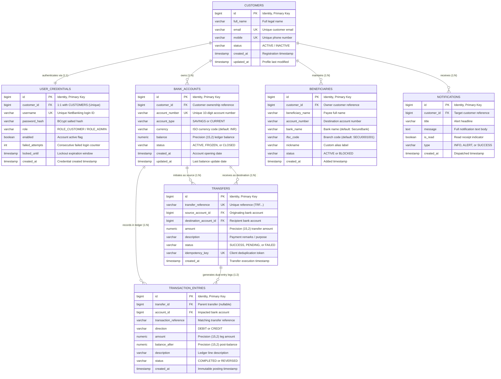

# 📊 SecureBank — Entity-Relationship (ER) Diagram & Schema Specification

This document provides the formal **Entity-Relationship (ER) Diagram**, relational schema, cardinality rules, and data dictionary for the **SecureBank Net-Banking Platform**, reflecting [`V1__init_schema.sql`](backend/src/main/resources/db/migration/V1__init_schema.sql) and the JPA entity mappings.

---

## 🏛️ High-Level Entity-Relationship (ER) Diagram



---

## 📋 Entity Dictionary & Relational Tables

### 1. `CUSTOMERS`
The core identity record storing customer KYC details.
- **`id`** (`BIGINT`, PK): Auto-incrementing customer identifier.
- **`full_name`** (`VARCHAR(120)`, NOT NULL): Customer's legal name.
- **`email`** (`VARCHAR(120)`, NOT NULL, UNIQUE): Verified contact email.
- **`mobile`** (`VARCHAR(20)`, NOT NULL, UNIQUE): Verified mobile number.
- **`status`** (`VARCHAR(30)`, NOT NULL, DEFAULT `'ACTIVE'`): Lifecycle status (`ACTIVE`, `SUSPENDED`).
- **`created_at` / `updated_at`** (`TIMESTAMP`, NOT NULL): Audit timestamps.

### 2. `USER_CREDENTIALS`
Authentication and security enforcement attributes separated from identity for clean security separation.
- **`id`** (`BIGINT`, PK): Credential row identifier.
- **`customer_id`** (`BIGINT`, FK $\rightarrow$ `customers.id`, UNIQUE): Enforces **strict 1:1 relationship** with customer.
- **`username`** (`VARCHAR(50)`, NOT NULL, UNIQUE): Customer ID used for NetBanking login (e.g., `customer101`).
- **`password_hash`** (`VARCHAR(255)`, NOT NULL): BCrypt hash with salt rounds.
- **`role`** (`VARCHAR(30)`, NOT NULL, DEFAULT `'ROLE_CUSTOMER'`): Spring Security authority.
- **`enabled`** (`BOOLEAN`, NOT NULL, DEFAULT `TRUE`): Login authorization switch.
- **`failed_attempts`** (`INT`, NOT NULL, DEFAULT `0`): Failed authentication counter for automated lockout.
- **`locked_until`** (`TIMESTAMP`, NULLABLE): Lockout window after 5 consecutive failed logins.

### 3. `BANK_ACCOUNTS`
Bank accounts owned by a customer. Supports multiple accounts per customer.
- **`id`** (`BIGINT`, PK): Account internal identifier.
- **`customer_id`** (`BIGINT`, FK $\rightarrow$ `customers.id`, NOT NULL): Account holder reference.
- **`account_number`** (`VARCHAR(20)`, NOT NULL, UNIQUE): Unique public account number (e.g., `1001002345`).
- **`account_type`** (`VARCHAR(30)`, NOT NULL, DEFAULT `'SAVINGS'`): Account classification (`SAVINGS`, `CURRENT`).
- **`currency`** (`VARCHAR(10)`, NOT NULL, DEFAULT `'INR'`): ISO 4217 currency.
- **`balance`** (`NUMERIC(15,2)`, NOT NULL, DEFAULT `0.00`): Authoritative account balance.
- **`status`** (`VARCHAR(30)`, NOT NULL, DEFAULT `'ACTIVE'`): Account state (`ACTIVE`, `FROZEN`, `CLOSED`).

### 4. `TRANSFERS`
Captures high-level fund transfer intent, lifecycle state, and client-side idempotency.
- **`id`** (`BIGINT`, PK): Transfer identifier.
- **`transfer_reference`** (`VARCHAR(64)`, NOT NULL, UNIQUE): Public payment receipt reference (`TRF...`).
- **`source_account_id`** (`BIGINT`, FK $\rightarrow$ `bank_accounts.id`, NOT NULL): Originating account.
- **`destination_account_id`** (`BIGINT`, FK $\rightarrow$ `bank_accounts.id`, NOT NULL): Beneficiary account.
- **`amount`** (`NUMERIC(15,2)`, NOT NULL): Transferred monetary amount ($> 0.00$).
- **`idempotency_key`** (`VARCHAR(100)`, UNIQUE, NULLABLE): Client UUID preventing duplicate requests.
- **`status`** (`VARCHAR(30)`, NOT NULL, DEFAULT `'SUCCESS'`): Status (`SUCCESS`, `FAILED`, `PENDING`).

### 5. `TRANSACTION_ENTRIES` (Double-Entry Ledger)
Immutable journal ledger entries adhering to balanced double-entry accounting.
- **`id`** (`BIGINT`, PK): Ledger entry identifier.
- **`transfer_id`** (`BIGINT`, FK $\rightarrow$ `transfers.id`, NULLABLE): Associated parent transfer.
- **`account_id`** (`BIGINT`, FK $\rightarrow$ `bank_accounts.id`, NOT NULL): Impacted account.
- **`transaction_reference`** (`VARCHAR(64)`, NOT NULL): Transaction trace code.
- **`direction`** (`VARCHAR(10)`, NOT NULL): Leg direction (`DEBIT` or `CREDIT`).
- **`amount`** (`NUMERIC(15,2)`, NOT NULL): Transaction leg value.
- **`balance_after`** (`NUMERIC(15,2)`, NOT NULL): Snapshot of account balance immediately following execution.
- **`status`** (`VARCHAR(30)`, NOT NULL, DEFAULT `'COMPLETED'`): Posting state (`COMPLETED`, `REVERSED`).

### 6. `BENEFICIARIES`
Directory of verified payees saved by customers for quick transfers.
- **`id`** (`BIGINT`, PK): Payee record identifier.
- **`customer_id`** (`BIGINT`, FK $\rightarrow$ `customers.id`, NOT NULL): Owning customer.
- **`beneficiary_name`** (`VARCHAR(120)`, NOT NULL): Name of beneficiary.
- **`account_number`** (`VARCHAR(20)`, NOT NULL): Payee account number.
- **`bank_name`** (`VARCHAR(100)`, DEFAULT `'SecureBank'`): Recipient financial institution.
- **`ifsc_code`** (`VARCHAR(20)`, DEFAULT `'SECU0001001'`): Routing branch code.
- **`nickname`** (`VARCHAR(60)`, NULLABLE): User alias (e.g., "Landlord Rent").

### 7. `NOTIFICATIONS`
Customer activity and alert messages.
- **`id`** (`BIGINT`, PK): Notification identifier.
- **`customer_id`** (`BIGINT`, FK $\rightarrow$ `customers.id`, NOT NULL): Recipient customer.
- **`title`** (`VARCHAR(150)`, NOT NULL): Short notification title.
- **`message`** (`TEXT`, NOT NULL): Full notification body.
- **`is_read`** (`BOOLEAN`, NOT NULL, DEFAULT `FALSE`): Read state.
- **`type`** (`VARCHAR(50)`, NOT NULL, DEFAULT `'INFO'`): Category (`INFO`, `ALERT`, `SUCCESS`).

---

## 🔗 Cardinality & Relationship Matrix

| Primary Entity | Foreign Entity | Relationship | Cardinality | Business Meaning / Integrity Rule |
| :--- | :--- | :---: | :---: | :--- |
| `CUSTOMERS` | `USER_CREDENTIALS` | One-to-One | $1 : 1$ | A customer has exactly one login profile (`customer_id` is UNIQUE; CASCADE on delete). |
| `CUSTOMERS` | `BANK_ACCOUNTS` | One-to-Many | $1 : N$ | A customer can hold multiple savings/current accounts; every account belongs to exactly one customer. |
| `CUSTOMERS` | `BENEFICIARIES` | One-to-Many | $1 : N$ | A customer maintains a personal list of verified payees (CASCADE on delete). |
| `CUSTOMERS` | `NOTIFICATIONS` | One-to-Many | $1 : N$ | A customer receives real-time transactional and account alerts (CASCADE on delete). |
| `BANK_ACCOUNTS`| `TRANSFERS` (Source) | One-to-Many | $1 : N$ | An account can act as the funding source for multiple transfers. |
| `BANK_ACCOUNTS`| `TRANSFERS` (Dest) | One-to-Many | $1 : N$ | An account can receive funds from multiple transfers. |
| `BANK_ACCOUNTS`| `TRANSACTION_ENTRIES`| One-to-Many | $1 : N$ | An account possesses an ordered timeline of immutable debit and credit ledger rows. |
| `TRANSFERS` | `TRANSACTION_ENTRIES`| One-to-Many | $1 : 2$ | **Double-Entry Invariant:** Each valid transfer yields exactly **2** balanced ledger entries: one `DEBIT` for the sender and one `CREDIT` for the receiver. |

---

## ⚡ Performance Indexing Strategy

The following database indexes are pre-configured in `V1__init_schema.sql` to guarantee sub-millisecond query latency under high concurrent load:

```sql
CREATE INDEX idx_user_credentials_username ON user_credentials(username);
CREATE INDEX idx_bank_accounts_customer    ON bank_accounts(customer_id);
CREATE INDEX idx_bank_accounts_number      ON bank_accounts(account_number);
CREATE INDEX idx_tx_entries_account        ON transaction_entries(account_id);
CREATE INDEX idx_tx_entries_ref            ON transaction_entries(transaction_reference);
CREATE INDEX idx_beneficiaries_customer    ON beneficiaries(customer_id);
CREATE INDEX idx_notifications_customer    ON notifications(customer_id);
```
