# SecureBank — Enterprise Net-Banking Platform

<div align="center">

[](https://spring.io/projects/spring-boot)
[](https://www.oracle.com/java/)
[](https://angular.dev/)
[](https://www.typescriptlang.org/)
[](https://www.postgresql.org/)
[](http://localhost:8080/swagger-ui.html)
[](LICENSE)
[](CONTRIBUTORS.md)

**An enterprise-grade, full-stack net banking simulation engineered with balanced double-entry ledger bookkeeping, stateless JWT authentication, idempotent fund transfers, and a reactive Indian retail banking user interface.**

[Explore Features](#-key-features) • [System Architecture](#-architecture--system-design) • [ER Diagram](ER_DIAGRAM.md) • [Quick Start](#-getting-started) • [API Docs](#-api-documentation) • [Demo Credentials](#-synthetic-demo-credentials)

</div>

---

## 📸 Interface Preview

### Modern NetBanking Dashboard (Dark & Light Theme)

<div align="center">
  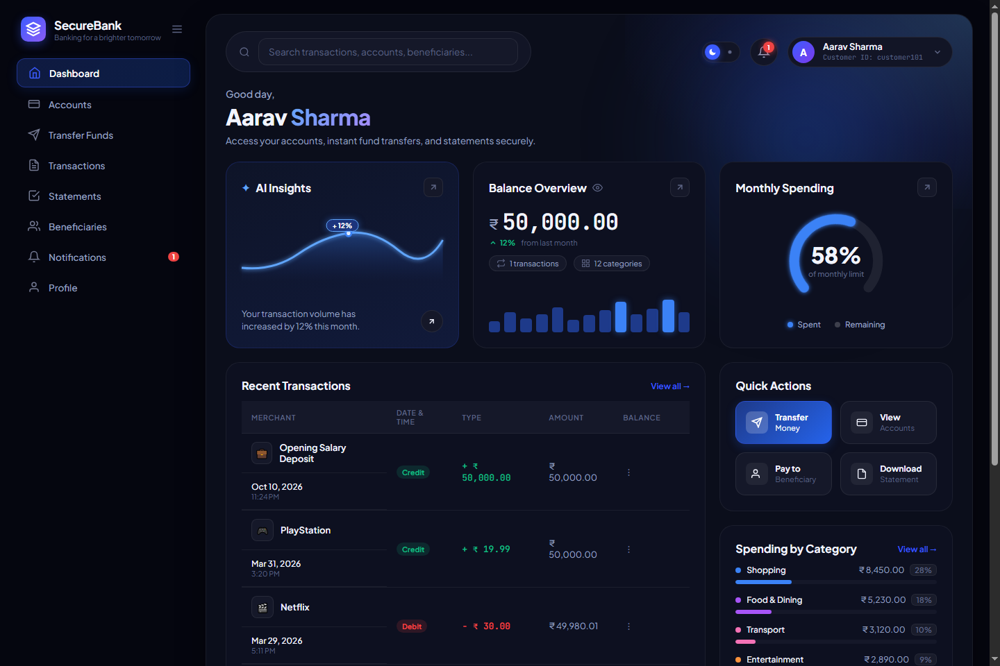
  <p><em>Desktop Dashboard: Real-time multi-account cards, quick payee carousel, recent transactions, and account actions.</em></p>
</div>

<br />

<table align="center" width="100%">
  <tr>
    <td width="65%" align="center" valign="top">
      <h4>☀️ Light Theme Portal</h4>
      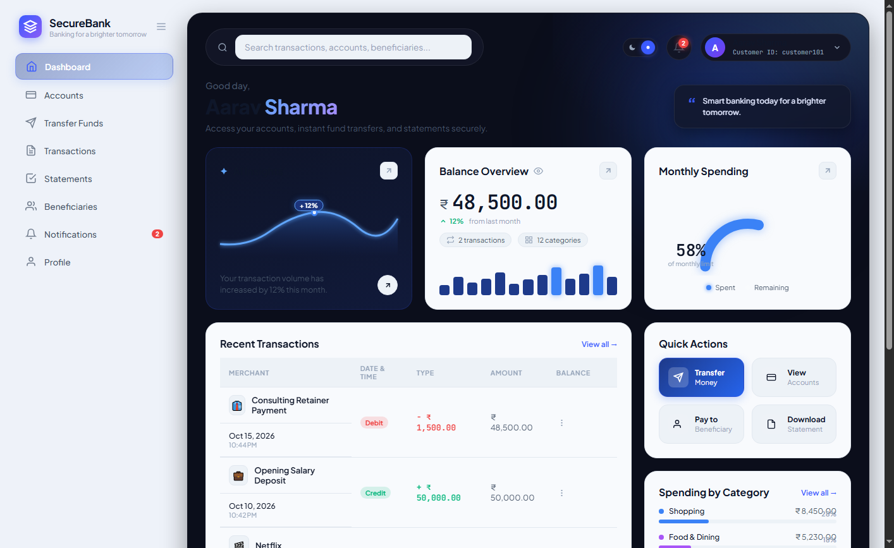
    </td>
    <td width="35%" align="center" valign="top">
      <h4>📱 Responsive Mobile UX (390px)</h4>
      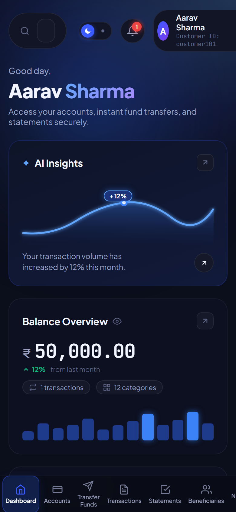
    </td>
  </tr>
</table>

---

## 📌 Executive Overview

### The Problem
Traditional college or tutorial banking implementations treat monetary transfers as primitive arithmetic operations: subtracting from column A and adding to column B in a loose database transaction. In real-world financial technology, this approach results in concurrency race conditions, orphaned balances, vulnerability to network replay attacks, and a lack of non-repudiation auditability.

### The Solution: SecureBank
**SecureBank** is an enterprise-oriented, full-stack online banking software platform designed to simulate the security, accounting rigor, and user experience of modern retail net-banking portals (such as HDFC, ICICI, and SBI). 

Key engineering characteristics:
- **Balanced Double-Entry Bookkeeping:** Every transaction records corresponding immutable debit and credit journal entries (`TransactionEntry`) with snapshot balances rather than simple field overwrites.
- **Transactional Atomicity & Isolation:** Fund transfers operate under strict `@Transactional(isolation = Isolation.READ_COMMITTED)` boundaries to eliminate dirty and non-repeatable reads during balance updates.
- **Idempotent Transfer Pipeline:** Supports client-generated idempotency keys to ensure intermittent connection drops cannot cause duplicate fund dispatches.
- **Defensive Multi-Tenant Access:** Every account read and write strictly enforces ownership checks (`findByIdAndCustomerId`) directly from the verified Spring Security context.
- **Zero-Friction Local Orchestration:** Automated one-click execution script (`Start.bat` / `Start.ps1`) that self-validates runtimes and orchestrates the Java backend and Angular frontend concurrently.

---

## 🌟 Key Features

| Feature | Category | Description | Technical Implementation |
| :--- | :--- | :--- | :--- |
| **Multi-Account Portfolio** | Account Management | Manage primary and secondary Savings and Current accounts with balance masking and status verification. | `AccountService.java`, Spring Data JPA dynamic querying with customer-scoped ownership filters. |
| **Atomic Fund Transfers** | Financial Core | Execute account-to-account funds transfers with strict validation, receiver existence checks, and self-transfer blocks. | `TransferService.java`, `@Transactional(isolation = Isolation.READ_COMMITTED)`, `SecureRandom` transaction reference generator. |
| **Idempotency Protection** | Reliability | Prevents double-charge risks when users retry transfers during flaky network connections. | Unique `idempotency_key` constraint checked at transfer ingestion before balance mutations. |
| **Double-Entry Ledger** | Compliance & Audit | Complete immutable audit trail capturing transaction references, debit/credit legs, timestamps, and balance snapshots. | `TransactionEntry` entity table indexed on `account_id` and `transaction_reference`. |
| **Beneficiary Directory** | Payee Operations | Save, search, and delete verified beneficiaries with IFSC validation, nickname support, and quick-payee strips. | `BeneficiaryController.java`, foreign-key cascaded mapping to customer entity. |
| **Statement Engine & CSV Export** | Reporting | Real-time statement calculation yielding opening balance, total debits, total credits, and closing balance with CSV download. | Streaming CSV generation via HTTP `text/csv` attachment (`Content-Disposition`). |
| **In-App Notification Center** | Real-Time Alerts | Automated notifications dispatched upon successful debits, incoming credits, and account events. | `NotificationService.java` with instant unread badges and mark-as-read toggles. |
| **Brute-Force Lockout** | Security | Defends against credential stuffing by tracking consecutive failed login attempts and locking accounts after 5 failures. | `UserCredential.failed_attempts` tracking with automated account lockout logic in `AuthService.java`. |
| **Dynamic Dual-Theme Engine** | UI / UX | Seamless Dark Mode and Light Mode switching with localStorage persistence and OS preference detection. | CSS custom design tokens (`tokens.css`) paired with Angular reactive signals (`ThemeService.ts`). |

---

## 🖥️ Screen Demonstrations

<table align="center" width="100%">
  <tr>
    <td width="50%" align="center" valign="top">
      <h4>🔐 1. Authentication & Sign In</h4>
      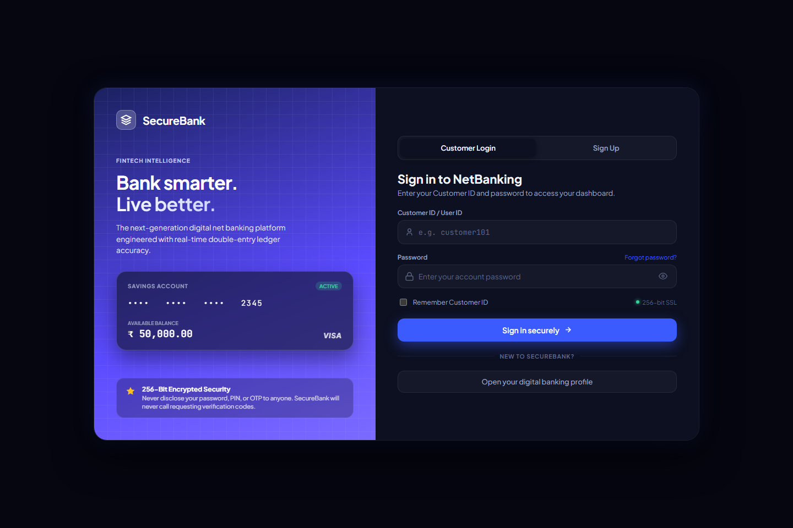
      <p align="left"><em>Customer login with Customer ID / Password, input validation, and password visibility toggles.</em></p>
    </td>
    <td width="50%" align="center" valign="top">
      <h4>📝 2. Customer Registration</h4>
      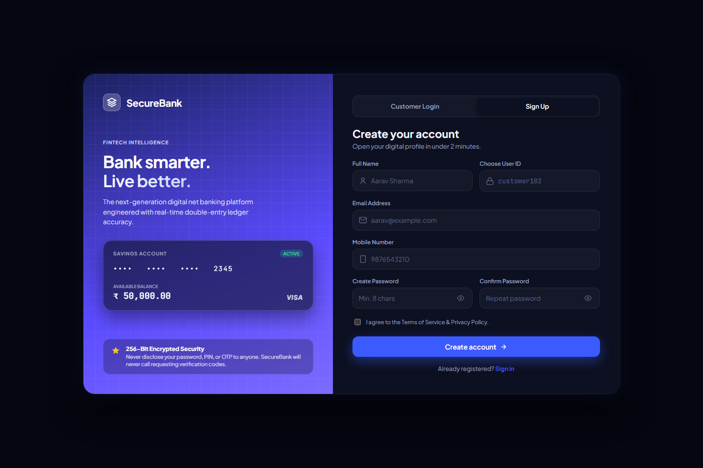
      <p align="left"><em>Full-service onboarding: creates customer profile, credentials, and activates an initial Savings Account.</em></p>
    </td>
  </tr>
  <tr>
    <td width="50%" align="center" valign="top">
      <h4>💳 3. Account Management</h4>
      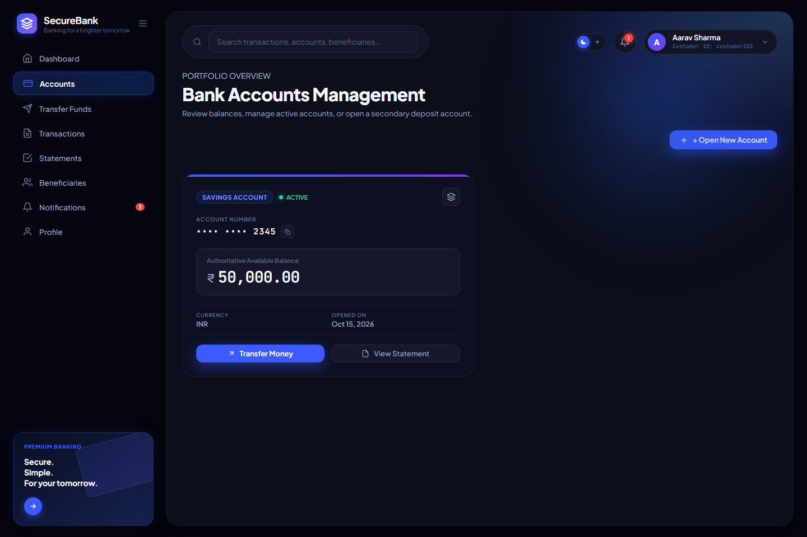
      <p align="left"><em>Portfolio overview: account cards, active balances, and one-click opening for secondary accounts.</em></p>
    </td>
    <td width="50%" align="center" valign="top">
      <h4>💸 4. Fund Transfers & Review</h4>
      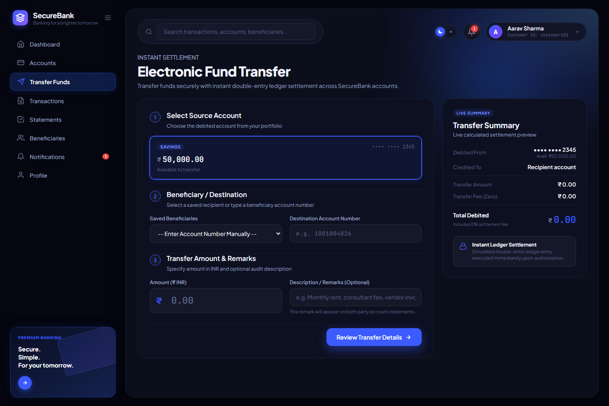
      <p align="left"><em>Source account selector, saved payee picker, real-time balance checks, and confirmation review modal.</em></p>
    </td>
  </tr>
  <tr>
    <td width="50%" align="center" valign="top">
      <h4>👥 5. Beneficiary Directory</h4>
      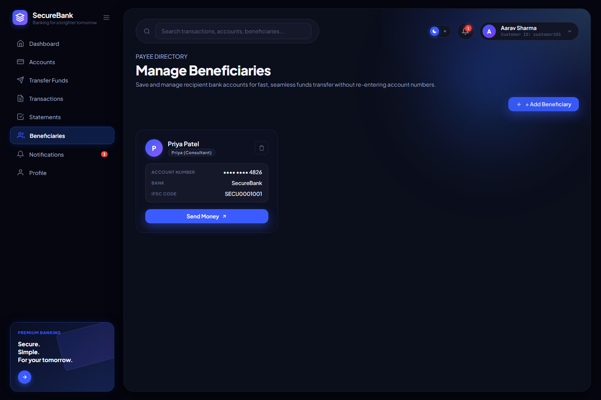
      <p align="left"><em>Manage trusted payees with bank names, IFSC codes, nicknames, and direct payment action shortcuts.</em></p>
    </td>
    <td width="50%" align="center" valign="top">
      <h4>📜 6. Transaction Ledger</h4>
      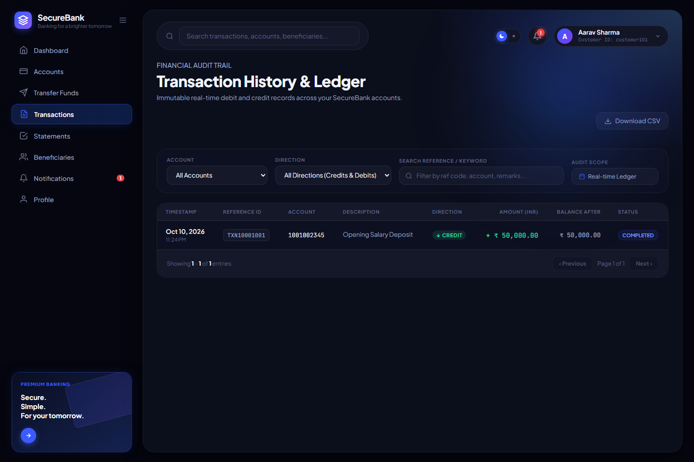
      <p align="left"><em>Paginated ledger with search filters, debit/credit badges, post-transaction balances, and reference IDs.</em></p>
    </td>
  </tr>
  <tr>
    <td width="50%" align="center" valign="top">
      <h4>📊 7. Statements & CSV Export</h4>
      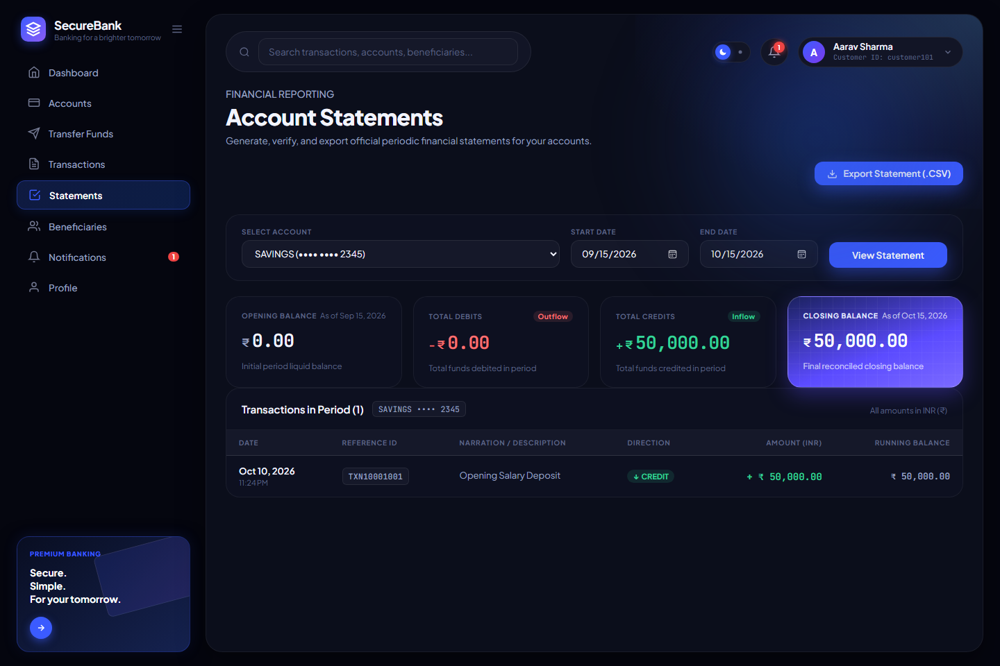
      <p align="left"><em>Date range statement generator calculating opening balance, net change, and 1-click RFC 4180 CSV export.</em></p>
    </td>
    <td width="50%" align="center" valign="top">
      <h4>🔔 8. Notifications Center</h4>
      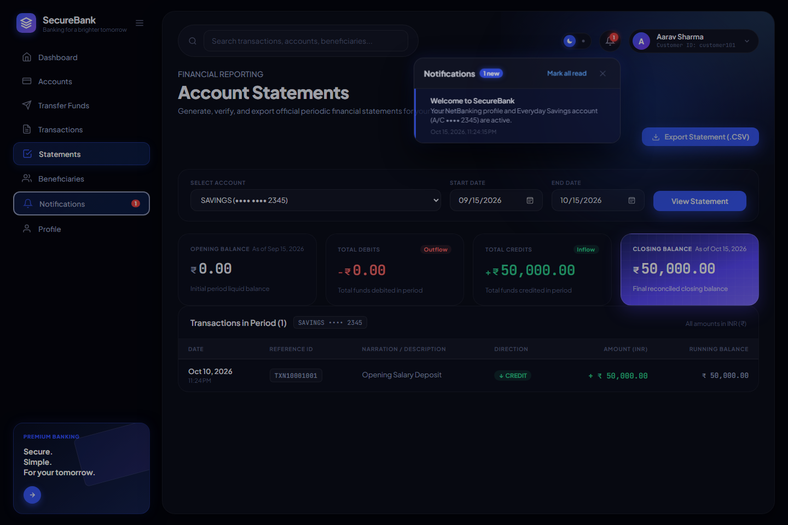
      <p align="left"><em>In-app event notifications for outgoing transfers, incoming credits, and system security alerts.</em></p>
    </td>
  </tr>
</table>

---

## 🛠️ Technology Stack

```
SecureBank
├── Frontend: Angular 22 (Standalone Components + Signals + Lucide Icons)
├── Backend:  Spring Boot 3.4.3 (Java 21 + Spring Security 6 + Spring Data JPA)
├── Database: H2 (Embedded Dev) / PostgreSQL 16+ (Production Ready via Flyway)
└── API Spec: OpenAPI 3.0 / Swagger UI
```

### Verified Dependencies & Rationale

| Layer | Technology | Version | Purpose in SecureBank |
| :--- | :--- | :--- | :--- |
| **Frontend Framework** | **Angular** | `22.2.0` | Modern standalone component architecture without legacy `NgModule` boilerplate; clean separation of concerns. |
| **State & Reactivity** | **Angular Signals & RxJS** | `~7.8.0` | Fine-grained reactivity for UI theme toggles, account balance sync, and async HTTP stream transformations. |
| **Icons & Design** | **Lucide Angular** | `^1.55.0` | Crisp, uniform SVG icon library for banking actions, financial cards, and status tags. |
| **Backend Runtime** | **Java OpenJDK** | `21` | Modern LTS Java featuring pattern matching, record classes, and virtual thread readiness. |
| **Backend Framework** | **Spring Boot** | `3.4.3` | Production-ready microframework for REST APIs, dependency injection, and declarative transaction management. |
| **Security & Auth** | **Spring Security + JJWT** | `0.12.6` | Stateless JWT token issuance, verification filter chain, and BCrypt salted password hashing. |
| **ORM & Data Access** | **Spring Data JPA / Hibernate** | `3.4.3` | Object-Relational Mapping, type-safe repositories, and pessimistic/read-committed transaction handling. |
| **Database Migration** | **Flyway Core** | `10.x` | Version-controlled database schema migrations (`V1__init_schema.sql`) ensuring deterministic schema creation across environments. |
| **Database (Dev)** | **H2 Database** | Runtime | Postgres-mode in-memory database enabling instantaneous zero-install local development and testing. |
| **Database (Prod)** | **PostgreSQL** | `16+` | Enterprise relational database support activated via the `postgres` Spring profile. |
| **API Documentation** | **SpringDoc OpenAPI** | `2.8.5` | Automated OpenAPI 3.0 specification generation and interactive Swagger UI explorer. |
| **Unit Testing** | **JUnit 5 + Mockito** | Built-in | Isolated unit tests validating authentication limits, business validations, and transfer invariants. |

---

## 🏗️ Architecture & System Design

SecureBank follows a **Layered Hexagonal Architecture** with distinct presentation, application, domain, and infrastructure layers:

### High-Level System Architecture

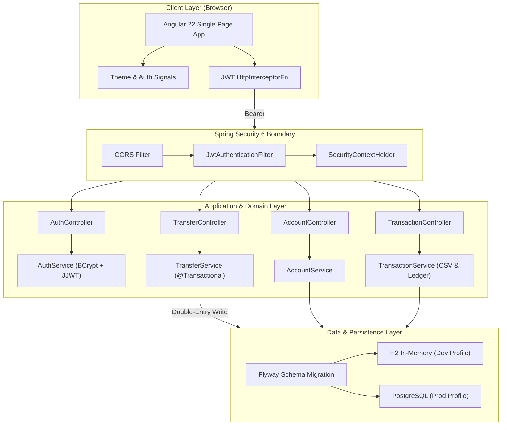

### Atomic Fund Transfer Sequence (Double-Entry Execution)

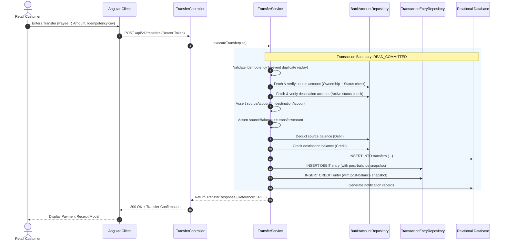

### 📊 Database Schema & Entity-Relationship (ER) Diagram

A comprehensive Entity-Relationship diagram documenting primary/foreign keys, 1:1 and 1:N cardinalities, double-entry ledger invariants, and database index configurations is documented in:
👉 [**`ER_DIAGRAM.md` — Full Entity-Relationship (ER) Diagram & Schema Specification**](ER_DIAGRAM.md)

---

## 🚀 Getting Started

### Prerequisites

| Runtime | Required Version | Verification Command | Download |
| :--- | :--- | :--- | :--- |
| **Java JDK** | 21 or higher | `java -version` | [Adoptium Temurin 21](https://adoptium.net/) |
| **Node.js** | 18.x or 20.x+ | `node -v` | [Node.js Official](https://nodejs.org/) |
| **npm** | 9.x or higher | `npm -v` | Included with Node.js |
| **Git** | 2.x+ | `git --version` | [Git SCM](https://git-scm.com/) |

*(Note: Maven is not required to be installed manually; the repository includes the verified Maven Wrapper `mvnw` and `mvnw.cmd`).*

---

### Step 1: Clone the Repository
```bash
git clone https://github.com/atharva1407-sys/Net-Banking-Software.git
cd Net-Banking-Software
```

---

### Step 2: Run with One Click (Windows)

Simply double-click [`Start.bat`](Start.bat) in the root directory, or run from PowerShell:
```powershell
.\Start.ps1
```
This automated script:
1. Validates that Java 21+ and Node.js are available in your `PATH`.
2. Starts the **Spring Boot API** on `http://localhost:8080` in a dedicated shell.
3. Automatically applies database migrations via Flyway and seeds initial test customers.
4. Launches the **Angular Frontend** on `http://localhost:4200` in a parallel shell.

---

### Step 3: Manual Execution (Cross-Platform / macOS / Linux)

If you prefer running services independently:

#### 1. Launch the Backend
```bash
cd backend
# Windows:
./mvnw.cmd spring-boot:run

# macOS / Linux:
chmod +x mvnw
./mvnw spring-boot:run
```
> The API will be available at **`http://localhost:8080`**  
> Interactive Swagger UI will be live at **`http://localhost:8080/swagger-ui.html`**

#### 2. Launch the Frontend
Open a new terminal window:
```bash
cd frontend
npm install
npm start
```
> The NetBanking portal will be live at **`http://localhost:4200`**

---

## 🌐 Service Endpoints & Access

| Service | Access URL | Credentials / Notes |
| :--- | :--- | :--- |
| **NetBanking Frontend** | [http://localhost:4200](http://localhost:4200) | Main retail portal |
| **Interactive Swagger UI** | [http://localhost:8080/swagger-ui.html](http://localhost:8080/swagger-ui.html) | OpenAPI 3.0 interactive testing |
| **OpenAPI Specification** | [http://localhost:8080/v3/api-docs](http://localhost:8080/v3/api-docs) | Machine-readable API schema |
| **H2 Database Console** | [http://localhost:8080/h2-console](http://localhost:8080/h2-console) | JDBC URL: `jdbc:h2:mem:securebank`, User: `sa`, Password: *(leave empty)* |

---

## 🔑 Synthetic Demo Credentials

The application automatically seeds safe, synthetic demo accounts on first launch:

| Role / Profile | Customer ID | Password | Full Name | Primary Account | Balance |
| :--- | :--- | :--- | :--- | :--- | :--- |
| **Customer 1** | `customer101` | `Password@123` | Aarav Sharma | Savings •••• `2345` | ₹50,000.00 |
| **Customer 2** | `customer102` | `Password@123` | Priya Patel | Current •••• `4826` | ₹1,20,000.00 |

> **Self-Registration:** You can also click the **Sign Up** tab on the login screen to register a new customer profile. An initial Savings Account with synthetic starting funds will be provisioned immediately.

---

## ⚙️ Configuration & Environment Variables

Configuration is organized via Spring Profiles in [`backend/src/main/resources/application.yml`](backend/src/main/resources/application.yml):

| Property / Environment Variable | Default (Dev Profile) | Production Profile | Purpose |
| :--- | :--- | :--- | :--- |
| `spring.profiles.active` | `dev` | `postgres` | Selects active configuration profile |
| `server.port` | `8080` | `8080` | Port for the backend REST API |
| `SPRING_DATASOURCE_URL` | `jdbc:h2:mem:securebank;...` | `jdbc:postgresql://localhost:5432/securebank` | JDBC database connection string |
| `SPRING_DATASOURCE_USERNAME` | `sa` | `postgres` | Database username |
| `SPRING_DATASOURCE_PASSWORD` | *(empty)* | `postgres` | Database password |
| `securebank.jwt.secret` | *Pre-configured 256-bit key* | Set via environment | HMAC-SHA secret for signing JWT tokens |
| `securebank.jwt.expiration-ms` | `86400000` (24h) | `86400000` | JWT expiration duration in milliseconds |

> [!WARNING]
> Never commit real production secrets, credentials, or private keys to source control. For production deployments, pass database credentials and `securebank.jwt.secret` via environment variables.

---

## 📂 Project Directory Structure

```
Banking System/
├── backend/                               # Spring Boot 3.4.3 Backend Service
│   ├── mvnw & mvnw.cmd                    # Maven Wrapper executable scripts
│   ├── pom.xml                            # Backend dependencies & build plugins
│   └── src/
│       ├── main/
│       │   ├── java/com/securebank/
│       │   │   ├── SecureBankApplication.java
│       │   │   ├── account/               # Account entities, controllers & services
│       │   │   ├── auth/                  # Login, registration & credential handling
│       │   │   ├── beneficiary/           # Beneficiary management
│       │   │   ├── common/                # Standard API response envelopes & exceptions
│       │   │   ├── config/                # Spring Security, OpenAPI & DataInitializer
│       │   │   ├── customer/              # Customer profile & user credentials
│       │   │   ├── notification/          # In-app event alerts
│       │   │   ├── security/              # JWT filter, service & UserDetails
│       │   │   ├── transaction/           # Ledger entries, statement & CSV generation
│       │   │   └── transfer/              # Double-entry funds transfer logic
│       │   └── resources/
│       │       ├── application.yml        # Multi-profile Spring configuration
│       │       └── db/migration/
│       │           └── V1__init_schema.sql # Baseline relational Flyway schema
│       └── test/java/com/securebank/      # JUnit 5 & Mockito test suite
│           ├── AuthServiceTest.java       # Login & lockout verification tests
│           └── TransferServiceTest.java   # Transfer balance & invariant tests
│
├── frontend/                              # Angular 22 Single Page Application
│   ├── angular.json                       # Angular workspace configuration
│   ├── package.json                       # Frontend dependencies & scripts
│   ├── tsconfig.json                      # Strict TypeScript compiler options
│   └── src/
│       ├── index.html                     # Application entry HTML
│       ├── main.ts                        # Standalone bootstrapping
│       ├── styles.scss                    # Global style imports
│       ├── styles/                        # Tokens, layout & component design system
│       └── app/
│           ├── app.routes.ts              # Route definitions & guards
│           ├── core/
│           │   ├── guards/auth.guard.ts   # Route protection guard
│           │   ├── interceptors/jwt.interceptor.ts # Bearer token injection
│           │   ├── models/models.ts       # TypeScript contract models
│           │   └── services/              # HTTP client services (Auth, Transfer, etc.)
│           ├── features/
│           │   ├── accounts/              # Account portfolio components
│           │   ├── auth/login-signup/     # Combined Login & Registration UI
│           │   ├── beneficiaries/         # Payee management views
│           │   ├── dashboard/             # Main customer dashboard
│           │   ├── statements/            # Statement & CSV export views
│           │   ├── transactions/          # Paginated transaction ledger
│           │   └── transfers/             # Fund transfer workflows
│           └── shared/components/header/  # Global header with theme & notifications
│
├── screenshots/                           # UI capture assets referenced in documentation
├── .gitignore                             # Excludes node_modules, target, logs & dist
├── README.md                              # Professional project documentation
├── Start.bat                              # One-click Windows runner batch script
└── Start.ps1                              # One-click PowerShell runner script
```

---

## 📡 API Documentation

SecureBank conforms to standard RESTful design principles. All business responses are wrapped in a consistent generic envelope:

```json
{
  "success": true,
  "message": "Operation completed successfully.",
  "data": { ... },
  "timestamp": "2026-10-21T17:21:00Z"
}
```

### Core API Endpoints

| Category | Method | Endpoint | Description | Auth Required |
| :--- | :---: | :--- | :--- | :---: |
| **Auth** | `POST` | `/api/v1/auth/login` | Authenticate customer and issue JWT | No |
| **Auth** | `POST` | `/api/v1/auth/register` | Register new customer and create primary account | No |
| **Auth** | `GET` | `/api/v1/auth/me` | Fetch authenticated customer profile | **Yes (JWT)** |
| **Accounts** | `GET` | `/api/v1/accounts` | List customer bank accounts | **Yes (JWT)** |
| **Accounts** | `GET` | `/api/v1/accounts/{id}` | Get account details by ID | **Yes (JWT)** |
| **Accounts** | `GET` | `/api/v1/accounts/{id}/balance` | Real-time balance check | **Yes (JWT)** |
| **Accounts** | `POST` | `/api/v1/accounts` | Open secondary account (`SAVINGS` or `CURRENT`) | **Yes (JWT)** |
| **Transfers** | `POST` | `/api/v1/transfers` | Execute atomic double-entry transfer | **Yes (JWT)** |
| **Beneficiaries**| `GET` | `/api/v1/beneficiaries` | List saved transfer payees | **Yes (JWT)** |
| **Beneficiaries**| `POST` | `/api/v1/beneficiaries` | Add a new verified payee | **Yes (JWT)** |
| **Beneficiaries**| `DELETE`| `/api/v1/beneficiaries/{id}`| Remove a saved payee | **Yes (JWT)** |
| **Transactions** | `GET` | `/api/v1/transactions` | Paginated transaction history with filters | **Yes (JWT)** |
| **Statements** | `GET` | `/api/v1/statements` | Generate structured statement with balances | **Yes (JWT)** |
| **Statements** | `GET` | `/api/v1/statements/export` | Download statement as formatted CSV file | **Yes (JWT)** |
| **Notifications**| `GET` | `/api/v1/notifications` | Retrieve customer activity alerts | **Yes (JWT)** |
| **Notifications**| `PATCH`| `/api/v1/notifications/{id}/read` | Mark alert notification as read | **Yes (JWT)** |

<details>
<summary><b>🔍 Expand to View Sample API Payloads & Responses</b></summary>

#### 1. Customer Login
`POST /api/v1/auth/login`

**Request Body:**
```json
{
  "customerId": "customer101",
  "password": "Password@123"
}
```

**Response (200 OK):**
```json
{
  "success": true,
  "message": "Login successful.",
  "data": {
    "token": "eyJhbGciOiJIUzI1NiJ9...",
    "customerId": "customer101",
    "fullName": "Aarav Sharma",
    "email": "aarav.sharma@example.com",
    "mobile": "9876543210",
    "role": "ROLE_CUSTOMER",
    "internalCustomerId": 1
  },
  "timestamp": "2026-10-21T17:21:00.000"
}
```

---

#### 2. Fund Transfer Execution
`POST /api/v1/transfers`  
*Header: `Authorization: Bearer <token>`*

**Request Body:**
```json
{
  "sourceAccountId": 1,
  "destinationAccountNumber": "1001004826",
  "amount": 2500.00,
  "description": "Consulting retainer payment",
  "idempotencyKey": "9b1deb4d-3b7d-4bad-9bdd-2b0d7b3dcb6d"
}
```

**Response (200 OK):**
```json
{
  "success": true,
  "message": "Transfer completed successfully.",
  "data": {
    "transferReference": "TRF17295114605928124",
    "sourceAccountNumber": "1001002345",
    "destinationAccountNumber": "1001004826",
    "amount": 2500.00,
    "status": "SUCCESS",
    "description": "Consulting retainer payment",
    "updatedSourceBalance": 47500.00,
    "timestamp": "2026-10-21T17:21:00.000"
  },
  "timestamp": "2026-10-21T17:21:00.000"
}
```

</details>

---

## 🧪 Testing & Verification

The backend test suite is written using **JUnit 5** and **Mockito**, testing critical authentication boundaries, error propagation, and fund transfer state machines.

### Run Backend Unit Tests
```bash
cd backend
./mvnw.cmd test       # Windows
# or ./mvnw test       # macOS / Linux
```

**Verified Test Execution Results:**
```text
[INFO] -------------------------------------------------------
[INFO]  T E S T S
[INFO] -------------------------------------------------------
[INFO] Running com.securebank.AuthServiceTest
[INFO] Tests run: 3, Failures: 0, Errors: 0, Skipped: 0, Time elapsed: 2.227 s
[INFO] Running com.securebank.TransferServiceTest
[INFO] Tests run: 3, Failures: 0, Errors: 0, Skipped: 0, Time elapsed: 0.318 s
[INFO] 
[INFO] Results:
[INFO] Tests run: 6, Failures: 0, Errors: 0, Skipped: 0
[INFO] ------------------------------------------------------------------------
[INFO] BUILD SUCCESS
[INFO] ------------------------------------------------------------------------
```

### Run Frontend Production Build & Tests
```bash
cd frontend
# Build validation:
npm run build

# Unit tests via Vitest:
npm test
```

---

## 🛡️ Security Implementation

SecureBank employs a multi-layered defensive security architecture designed specifically for financial applications:

1. **Stateless JWT Authentication:**
   Sessions are non-sticky and stateless. Every request carries an `Authorization: Bearer <token>` signed via HMAC-SHA256 (`io.jsonwebtoken`), validated before reaching business controllers.
2. **Cryptographic Password Security:**
   Raw passwords are never stored. The system hashes credentials via `BCryptPasswordEncoder` with internal work factor salt rounds.
3. **Automated Account Lockout:**
   To mitigate automated brute-force password guessing, the application tracks `failed_attempts` on each user. Reaching 5 consecutive failures triggers an automated account lock.
4. **Customer-Scoped Authorization:**
   Even with a valid JWT, access to bank accounts and transactions is restricted to the token owner. Queries enforce `findByIdAndCustomerId(accountId, customer.getId())`, preventing Insecure Direct Object References (IDOR).
5. **Double-Entry Balance Invariants:**
   Balances cannot be updated in isolation. Every balance modification must accompany matching debit and credit ledger rows and is verified against non-negative constraint rules.
6. **SQL Injection Elimination:**
   All queries use Spring Data JPA parameter bindings and ORM mappings; no direct string concatenation is executed against SQL statements.

---

## 💡 Engineering Highlights

- **Idempotency Key Mechanism:** Network dropouts often cause users to click "Pay" twice. SecureBank allows client-generated idempotency keys, guaranteeing that re-transmitting an identical request returns the original completed receipt without debiting the customer twice.
- **Double-Entry Journal:** Mimicking core banking accounting systems, each transfer generates two independent `TransactionEntry` ledger rows (one `DEBIT`, one `CREDIT`), recording post-transaction balance snapshots to maintain audit compliance.
- **Streaming CSV Generation:** Rather than loading large datasets into application memory or writing temp files to disk, the statement exporter formats and streams CSV records directly into the HTTP response buffer.
- **Reactive Angular Architecture:** Standalone components, strict typing, and reactive signals eliminate the overhead of dirty checking and ensure instantaneous theme and state transitions.

---

## 🗺️ Project Roadmap

- [x] Full customer registration and JWT session lifecycle
- [x] Multi-account portfolio with balance tracking
- [x] Double-entry ledger money transfer engine
- [x] Beneficiary directory with search and delete
- [x] Paginated transaction ledger with direction filters
- [x] Date-range account statement generation with streaming CSV export
- [x] Reactive Dark & Light Theme system
- [x] Zero-friction one-click run scripts (`Start.bat` / `Start.ps1`)
- [ ] Two-Factor Authentication (TOTP / SMS OTP simulation)
- [ ] Scheduled & recurring automatic standing transfers
- [ ] Formatted PDF statement downloads with digital bank signature stamp
- [ ] Multi-currency conversion support (INR / USD / EUR)
- [ ] Containerized deployment with `docker-compose.yml`

---

## 🤝 Contributing

Contributions to enhance SecureBank are welcome!

1. **Fork the Repository:** Click the **Fork** button on GitHub.
2. **Create a Feature Branch:**
   ```bash
   git checkout -b feature/your-feature-name
   ```
3. **Commit Your Changes:**
   ```bash
   git commit -m "feat: add recurring transfer scheduler"
   ```
4. **Push to Your Fork:**
   ```bash
   git push origin feature/your-feature-name
   ```
5. **Open a Pull Request:** Submit a PR against the `main` branch with a summary of the implemented feature and test verification.

---

## 📄 License

This project is licensed under the **MIT License** — feel free to use and adapt this project for educational and demonstration purposes.

---

## 👨‍💻 Team & Contributors

- **Project Lead:** **Atharva Mandlik** ([@atharva1407-sys](https://github.com/atharva1407-sys))
- **Team Members:** See the full list of project contributors and roles in [**`CONTRIBUTORS.md`**](CONTRIBUTORS.md).

*Special thanks to the Spring Boot, Angular, and Lucide Icons open-source communities for providing foundational tools for modern web software engineering.*
